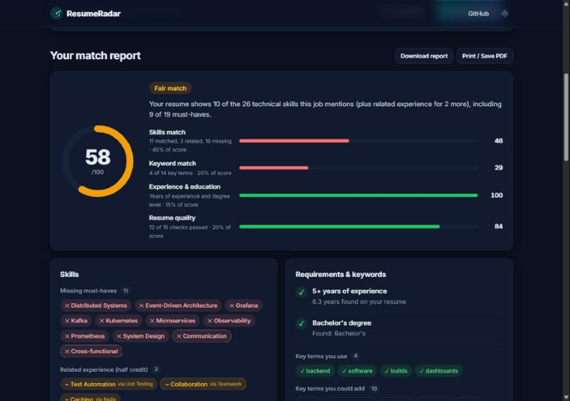
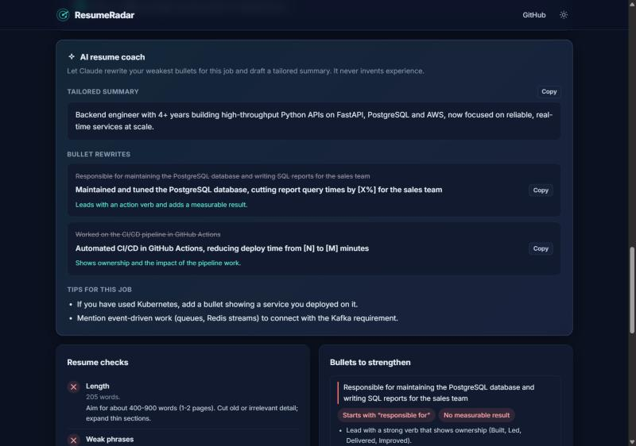
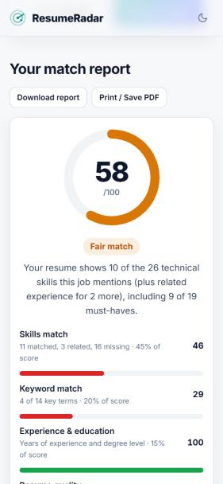

# 📡 ResumeRadar

**Check how well your resume matches a job description, and get told exactly what to fix.**

Upload your resume (PDF, DOCX or TXT), paste a job post, and ResumeRadar gives you a
match score, the must-have skills you're missing, keyword gaps, experience/degree checks,
an ATS-style quality review and line-by-line bullet feedback. An optional AI coach
(Claude) rewrites your weakest bullets for the job.

Free, private (files are processed in memory, never stored) and no sign-up.

[](https://github.com/Insofury/resume-radar/actions/workflows/ci.yml)
[](https://render.com/deploy?repo=https://github.com/Insofury/resume-radar)



<table>
  <tr>
    <td width="62%"></td>
    <td></td>
  </tr>
</table>

## Features

| | |
|---|---|
| 🎯 **Match score (0-100)** | Weighted from skills, keywords, experience & education, and resume quality - with a clear breakdown. |
| 🧩 **Skill gap analysis** | 260+ skills with aliases (k8s → Kubernetes, Postgres → PostgreSQL). Separates **must-haves** from **nice-to-haves** by reading the job post's sections. |
| 🔗 **Related-skill credit** | Pytest counts toward *Test Automation*, Redis toward *Caching*, and so on - with a tip to name the exact skill. |
| 🔑 **Keyword gaps** | Finds the job post's most repeated meaningful terms and checks whether you use them. |
| 🎓 **Experience & degree** | Works out your years of experience from date ranges (merging overlaps) and compares degree levels. |
| ✅ **15 resume checks** | Contact info, standard sections, length, quantified results, action verbs, weak phrases, clichés, pronouns, dates… |
| ✍️ **Bullet feedback** | Flags your weakest bullets and says why ("starts with 'responsible for'", "no measurable result"). |
| ✨ **AI coach (optional)** | With an Anthropic API key, Claude rewrites weak bullets, drafts a tailored summary and gives job-specific tips - without inventing experience. |
| 📄 **PDF / DOCX / TXT** | Upload or paste. Download the report as Markdown or print it to PDF. |
| 🌗 **Polished UI** | Dark/light themes, mobile-friendly, accessible, no tracking. |

## Quick start

Requires **Python 3.10+**.

```bash
git clone https://github.com/Insofury/resume-radar.git
cd resume-radar
python -m venv .venv
```

```bash
# Windows
.venv\Scripts\activate
# macOS / Linux
source .venv/bin/activate
```

```bash
pip install -r requirements.txt
python run.py
```

Open **http://localhost:8000** and click **Try a sample**.

To enable the AI coach, copy `.env.example` to `.env` and add your `ANTHROPIC_API_KEY`
(from [console.anthropic.com](https://console.anthropic.com)). Everything else works without a key.

## Deploy (free)

**Render:** click **Deploy to Render** above, sign in with GitHub, optionally paste an
`ANTHROPIC_API_KEY`, and click **Apply**. You get a public `onrender.com` URL that
redeploys on every push.

**Docker (anywhere):**

```bash
docker build -t resume-radar .
docker run -p 8000:8000 -e TRUST_PROXY=true resume-radar
```

## How the score works

| Part | Weight | What it measures |
|---|---|---|
| Skills match | 45% | Job skills found in your resume, weighted: must-have 1.0, nice-to-have 0.45, soft skills ×0.5, related skill = half credit |
| Keyword match | 20% | The job post's top repeated terms that appear in your resume |
| Experience & education | 15% | Years of experience vs required; degree level vs required |
| Resume quality | 20% | Weighted pass/warn/fail of 15 ATS and writing checks |

Parts that don't apply (e.g. no degree requirement) are skipped and the weights re-balanced.

## Project structure

```
resume-radar/
├── app/
│   ├── main.py         FastAPI routes + static site
│   ├── analyzer.py     the pipeline: score, breakdown, recommendations
│   ├── skills.py       skills taxonomy, aliases, matching, related skills
│   ├── job.py          job post parsing: must-have vs nice-to-have, years, degree
│   ├── resume.py       resume sections, contact info, bullets
│   ├── experience.py   date ranges -> years, degree detection
│   ├── checks.py       15 resume quality checks + bullet feedback
│   ├── textutils.py    normalisation, stemming, keyword extraction
│   ├── parsing.py      PDF / DOCX / TXT -> text (in memory)
│   ├── coach.py        optional Claude AI coach (structured JSON output)
│   ├── security.py     rate limiting, security headers, upload limits
│   ├── config.py       settings from environment variables
│   └── samples.py      sample resume + job post
├── static/             HTML, CSS and vanilla JS front-end
├── tests/              31 pytest tests (engine, parsing, API, coach)
└── docs/PROJECT_NOTES.md   full module-by-module guide
```

📘 See **[docs/PROJECT_NOTES.md](docs/PROJECT_NOTES.md)** for architecture diagrams and what
every module and function does.

## API

Interactive docs at **`/api/docs`**.

```bash
curl -F "resume_file=@resume.pdf" -F "job_text=<job.txt" http://localhost:8000/api/analyze
```

| Method | Path | Description |
|---|---|---|
| `POST` | `/api/analyze` | Form fields `job_text` + `resume_file` (or `resume_text`) → JSON report |
| `POST` | `/api/coach` | JSON `{resume_text, job_text, missing_skills, weak_bullets}` → AI suggestions |
| `GET` | `/api/config` | Feature flags and limits |
| `GET` | `/api/sample` | Sample resume and job post |
| `GET` | `/api/health` | Health check |

## Tests

```bash
pip install -r requirements-dev.txt
pytest -q
```

## Privacy

Uploaded files are read in memory, analysed and discarded - nothing is written to disk
or a database. When you use the AI coach, your resume and the job post are sent to
Anthropic's API to generate the suggestions.

## License

MIT - see [LICENSE](LICENSE).
