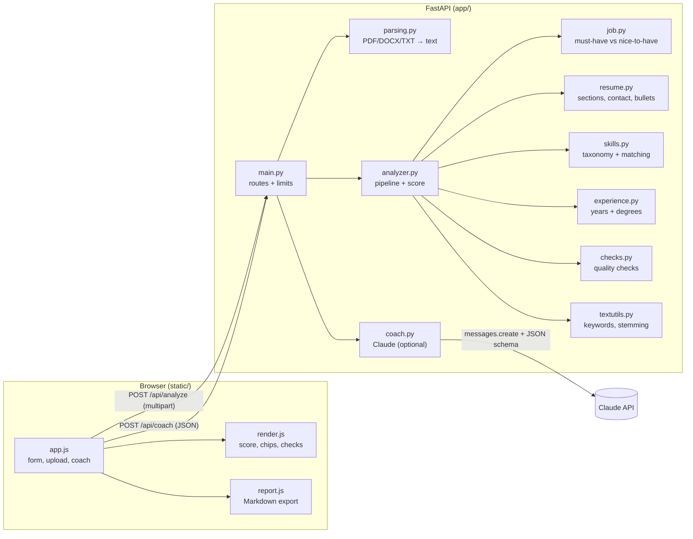
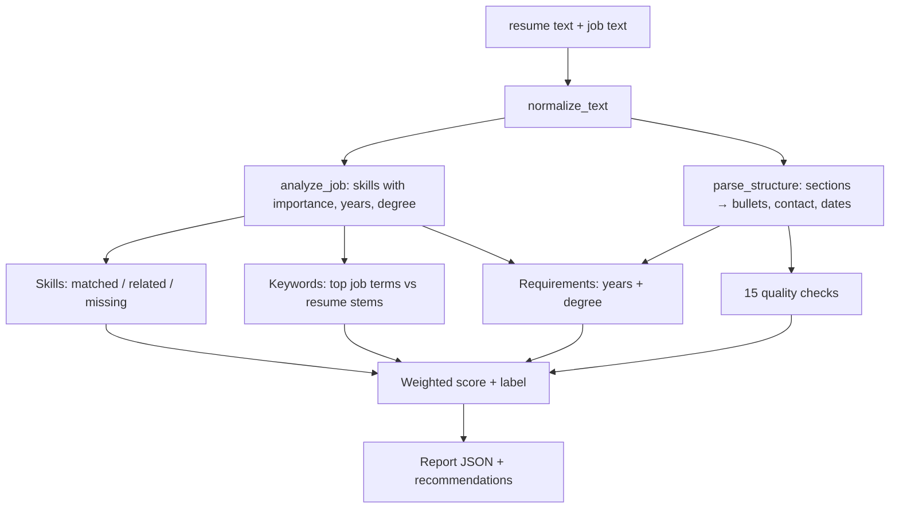

# ResumeRadar - Project Notes & Code Guide

These notes explain what ResumeRadar does, how the analysis works, and what every
module contains.

---

## 1. Summary

**ResumeRadar** is a Python web app that compares a resume with a job description. It
returns a 0-100 match score with a breakdown, skill and keyword gaps, experience and
degree checks, 15 resume-quality checks, bullet-by-bullet feedback and a prioritised
list of recommendations. An optional AI coach uses Claude to rewrite weak bullets for
the specific job.

| Item | Detail |
|---|---|
| Backend | Python 3.10+, FastAPI, Uvicorn |
| Analysis | Pure Python: regex skill taxonomy, light stemming, section parsing - no ML downloads, ~0.1 s per analysis |
| File parsing | `pypdf` for PDF, standard-library `zipfile` + `xml.etree` for DOCX, UTF-8 for TXT |
| AI coach | Optional: `anthropic` SDK, Claude Opus 5.5, structured JSON output, server-side refusal fallbacks |
| Frontend | Plain HTML, CSS and ES-module JavaScript (no build step, no external JS) |
| Storage | None - files are processed in memory and discarded |
| Tests | 31 pytest tests |
| Deploy | Render blueprint, Dockerfile, Procfile, GitHub Actions CI |

**Design choice:** the core analysis needs **no API key**, so the site is free to host
and fast. The AI coach is an add-on that switches on when `ANTHROPIC_API_KEY` is set.

---

## 2. Architecture



### Analysis pipeline (`analyzer.analyze`)



---

## 3. Folder structure

```
resume-radar/
├── app/
│   ├── __init__.py      version
│   ├── main.py          FastAPI app factory and routes
│   ├── config.py        Settings from env / .env
│   ├── analyzer.py      the analysis pipeline and scoring
│   ├── skills.py        skills taxonomy, matching, related-skill map
│   ├── job.py           job description parsing
│   ├── resume.py        resume structure, contact info, bullets
│   ├── experience.py    years of experience and degree detection
│   ├── checks.py        quality checks and bullet feedback
│   ├── textutils.py     normalisation, stemming, keyword extraction
│   ├── parsing.py       file → text
│   ├── coach.py         optional Claude AI coach
│   ├── security.py      rate limiter, headers, upload size limit
│   └── samples.py       sample resume and job post
├── static/
│   ├── index.html       page layout
│   ├── css/styles.css   design tokens, light/dark themes, print styles
│   ├── js/app.js        controller: inputs, API calls, AI coach
│   ├── js/render.js     renders the report
│   ├── js/report.js     Markdown export
│   └── js/theme.js      applies saved theme before paint
├── tests/
│   ├── helpers.py       builds real mini PDF and DOCX files
│   ├── test_engine.py   engine unit tests
│   └── test_api.py      parsing, routes, coach tests
├── docs/                these notes + screenshots
├── Dockerfile · render.yaml · Procfile · .github/workflows/ci.yml
└── requirements.txt · requirements-dev.txt · run.py · .env.example
```

---

## 4. Backend modules

### 4.1 `app/skills.py` - skills taxonomy and matching
- **`TAXONOMY`**: 266 skills in 11 categories (Languages, Frontend, Backend, Databases,
  Cloud & DevOps, Data & AI, Mobile, Tools, Engineering practices, Business & product,
  Soft skills). Each entry is `"Canonical|alias|alias"`; an alias starting with `=` is
  case-sensitive (used for `Go`, `React`, `Excel`, `R` - words that are also plain English).
- **`_boundary(alias)`**: builds a regex that matches the alias as a stand-alone token, so
  `C++`, `C#`, `.NET`, `Node.js` and `CI/CD` work, `Java` doesn't match inside `JavaScript`,
  and short tokens get stricter rules (`R` won't match `R&D`; `Go` won't match "go above").
- **`Skill`** dataclass and **`SKILLS` / `SKILLS_BY_NAME`**: compiled patterns.
- **`find_skills(text)`**: returns `{skill: [positions]}`. If one match lies inside a longer
  one (`React` inside `React Native`), only the longer skill counts.
- **`RELATED`**: partial-credit map (e.g. *Test Automation* ← Pytest/Jest/Selenium,
  *Observability* ← Prometheus/Grafana, *Caching* ← Redis).
- **`ALL_ALIASES`**: used to stop skills being double-counted as keywords.

### 4.2 `app/job.py` - understanding the job post
- **`_heading_kind(line)`**: decides whether a line is a section heading and which kind:
  `required` (Requirements, Qualifications, What you'll need…), `preferred` (Nice to
  have, Bonus, Preferred…), `responsibilities` (What you'll do…) or `other` (Benefits,
  About us…). A heading must end with `:`, be Title Case, or consist mostly of the matched
  phrase, so a line like "Kubernetes skills" isn't mistaken for a heading.
- **`classify_lines(text)`**: tags every line with its section; inline cues such as "is a
  plus" or "(preferred)" mark a single line as preferred.
- **`JobSkill`**: name, category, importance, mentions, soft flag; `weight` = 1.0 for
  must-haves, 0.45 for nice-to-haves, ×1.25 if mentioned 3+ times, ×0.5 for soft skills.
- **`analyze_job(text)`** → `JobProfile`: skills with importance, years required (largest
  "N+ years … experience" in required sections), lowest degree mentioned in required
  sections, and `keyword_text` (the post without benefits/about sections).

### 4.3 `app/resume.py` - resume structure
- **`SECTION_HEADINGS`**: patterns for Summary, Experience, Education, Skills, Projects,
  Certifications, Achievements.
- **`parse_structure(text)`** → `ResumeStructure`: line ranges for each section;
  `text_of(kind)` returns a section's text.
- **`contact_info(text)`**: email, phone (10-15 digits, ignoring year ranges), LinkedIn,
  GitHub and website.
- **`extract_bullets(structure)`**: bullet lines from Experience/Projects (glyphs like
  `•`, `-`, `▪`, numbered items), joins wrapped lines, and falls back to verb-led sentences
  when a pasted resume has no bullet characters.

### 4.4 `app/experience.py` - years and degrees
- **`date_ranges(text, today)`**: finds ranges like `Jan 2020 – Present`, `06/2019 - 2021`,
  `2016 - 2020` and converts them to month indexes (year-only dates count as mid-year).
- **`total_years(ranges)`**: merges overlapping ranges so two jobs at once count once.
- **`claimed_years(text)`**: "7+ years of experience" statements; the final figure is the
  larger of dates and claims.
- **`degree_levels / highest_degree / lowest_degree`**: detect associate, bachelor's
  (B.S., B.Tech, BSc…), master's (M.S., MBA, MSc…) and PhD - without matching "Scrum Master".
- **`years_mentioned(text)`**: "5+ years" phrases near the word "experience" in job posts.

### 4.5 `app/checks.py` - quality checks
- Word lists: **`ACTION_VERBS`** (~150), **`WEAK_PHRASES`** ("responsible for", "worked on"…),
  **`BUZZWORDS`** ("team player", "results-driven"…).
- Helpers: `starts_with_action_verb`, `weak_start`, `has_metric` (numbers, %, $, "2M+",
  "doubled", but not plain years like 2021).
- **`run_checks(...)`** → 15 `Check`s, each with status pass/warn/fail, detail, tip and
  weight: email, phone, LinkedIn, portfolio, standard sections, summary, length,
  bullets, quantified results, action verbs, concise bullets, weak phrases, buzzwords,
  pronouns, employment dates.
- **`quality_score(checks)`**: weighted average (pass 1, warn 0.5, fail 0).
- **`bullet_feedback(bullets)`**: the weakest bullets with their issues and specific tips.

### 4.6 `app/textutils.py` - text helpers
- **`normalize_text`**: Unicode NFKC (fixes PDF ligatures), whitespace cleanup, merges
  bullet glyphs that PDF extraction put on their own line.
- **`stem`**: a tiny suffix stripper (manage/managed/managing → "manag").
- **`STOPWORDS`, `GENERIC_JOB_WORDS`, `proper_nouns`**: filter out filler words, company
  names and bullet-leading verbs.
- **`extract_keywords(text, exclude, top_n)`**: repeated bigrams and the most frequent
  unigrams of the job post, excluding known skills.
- **`stem_sequence / contains_stems`**: fast phrase-presence checks on stemmed text.

### 4.7 `app/analyzer.py` - the pipeline
**`analyze(resume_text, job_text, today)`** runs everything and returns the report:
`score`, `label` (Excellent ≥80, Good ≥65, Fair ≥50, Needs work), `summary`, `breakdown`
(4 parts with weights 45/20/15/20), `skills` (matched / partial / missing / extra),
`keywords`, `requirements`, `checks`, `bullets`, `recommendations` (prioritised: missing
must-haves → related skills → years → degree → keywords → nice-to-haves → soft skills →
failed checks), `contact`, `stats` and the cleaned `resume_text` (used by the AI coach).

### 4.8 `app/parsing.py` - files to text
- **`extract_pdf`**: `pypdf`, first 10 pages; handles encrypted and broken files.
- **`extract_docx`**: reads `word/document.xml` directly; list paragraphs become `•` bullets;
  refuses oversized XML (zip-bomb guard).
- **`extract_text(filename, data)`**: dispatches by extension/magic bytes and raises
  **`ParseError`** with a friendly message (e.g. scanned PDFs with no text).

### 4.9 `app/coach.py` - optional AI coach
- **`SYSTEM_PROMPT`**: expert resume coach; never invents facts; uses `[X%]` placeholders
  for missing metrics.
- **`COACH_SCHEMA`**: JSON schema for `tailored_summary`, `bullet_rewrites[]`
  (original / improved / why) and `top_tips[]`, enforced with structured outputs
  (`output_config.format`).
- **`Coach.request_params`**: `claude-opus-5-5`, `effort: "medium"`, 16k max tokens and
  server-side refusal fallbacks (`fallbacks: "default"`).
- **`Coach.review`**: calls the API, handles `refusal` / `max_tokens` stop reasons, reads
  the text after any `fallback` block, validates with Pydantic (`CoachResult`) and maps
  SDK errors to friendly **`CoachError`** messages.

### 4.10 `app/security.py`, `app/config.py`, `app/main.py`
- **`RateLimiter`**: per-IP sliding window (30 analyses/min, 5 coach calls/min by default).
- **`client_ip`**: honours `X-Forwarded-For` only when `TRUST_PROXY=true`.
- **`BodySizeLimitMiddleware`**: rejects bodies over ~5.5 MB with HTTP 413.
- **`SecurityHeadersMiddleware`**: strict CSP (`script-src 'self'`), nosniff, frame deny.
- **`Settings.from_env`**: `ANTHROPIC_API_KEY`, `COACH_MODEL`, rate limits, `TRUST_PROXY`.
- **`create_app(settings, coach)`**: application factory; routes `/api/health`,
  `/api/config`, `/api/sample`, `/api/analyze`, `/api/coach`, `/`, `/static`, `/api/docs`.
  CPU-bound parsing and analysis run in a thread pool so the server stays responsive.

---

## 5. Frontend

- **`index.html`**: hero, two-panel input (upload/paste resume, job description), results
  section (score card, skills, requirements & keywords, recommendations, AI coach, checks,
  bullets).
- **`js/app.js`**: upload with drag-and-drop and validation, paste mode, sample loader,
  `POST /api/analyze` with `FormData`, AI coach flow (loading → results → copy buttons),
  Markdown download, print, theme toggle.
- **`js/render.js`**: animated SVG gauge and breakdown bars, colour-coded chips, status
  dots, recommendations, checks and bullet cards. All text is escaped before insertion.
- **`js/report.js`**: turns the report (plus AI suggestions) into a Markdown file.
- **`css/styles.css`**: design tokens with light/dark themes, responsive layout down to
  phone width, print stylesheet that prints only the report.

---

## 6. API reference

### `POST /api/analyze` (multipart form)
| Field | Required | Notes |
|---|---|---|
| `job_text` | yes | The job post (50 - 30,000 chars) |
| `resume_file` | one of | `.pdf`, `.docx`, `.txt`, `.md`, max 5 MB |
| `resume_text` | one of | Plain text (50 - 60,000 chars) |

Errors: `400` (validation / unreadable file), `413` (too large), `429` (rate limited).

### `POST /api/coach` (JSON)
`{"resume_text", "job_text", "missing_skills": [], "weak_bullets": []}` →
`{"tailored_summary", "bullet_rewrites": [{"original","improved","why"}], "top_tips": []}`.
`503` if no API key is configured, `502` with a friendly message if the AI call fails.

---

## 7. Testing

`pytest -q` runs 31 tests:
- **Engine** - tricky skill matching (C++, .NET, React Native vs React, Go vs "go above",
  R vs R&D), stemming, keyword filtering, date-range maths with overlaps, degree detection,
  must-have vs nice-to-have parsing, resume structure, bullet helpers, the full sample
  analysis, and that a stronger resume scores higher than a weaker one.
- **API & parsing** - real generated PDF and DOCX files, bad files, every route, upload
  limits, rate limiting, and the AI coach with a fake Claude client (structured output
  params, fallback handling, refusals, invalid JSON, API errors).

---

## 8. How to extend

| Goal | Where |
|---|---|
| Add a skill or alias | `TAXONOMY` in `skills.py` |
| Give partial credit for a related skill | `RELATED` in `skills.py` |
| Change score weights | `WEIGHTS` in `analyzer.py` |
| Add a quality check | `run_checks` in `checks.py` |
| Support another file type | `extract_text` in `parsing.py` |
| Change the AI coach output | `COACH_SCHEMA` + `CoachResult` in `coach.py` and `renderCoach` in `app.js` |
